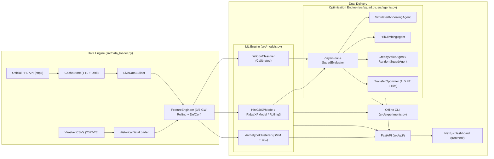

# Project Proposal — FPL-Optimus

**Title:** *FPL-Optimus: An Automated Fantasy Premier League Squad Selector, Transfer Optimizer, and Live Tracking Dashboard using Machine Learning and Local Search Optimization*

---

## 1. Motivation & Problem Statement

Fantasy Premier League (FPL) is a multi-period combinatorial decision problem played by over 11 million managers worldwide. Each gameweek, a manager must maintain a 15-player squad ($2\text{ GK}, 5\text{ DEF}, 5\text{ MID}, 3\text{ FWD}$) subject to strict hard constraints:

1. **Budget constraint:** Total squad cost $\le £100.0\text{m}$ (or dynamic selling value + bank).
2. **Club diversity quota:** At most 3 players from any single Premier League club.
3. **Formation legality:** A starting XI containing $1\text{ GK}$, at least $3\text{ DEF}$, at least $2\text{ MID}$, and at least $1\text{ FWD}$, with a designated Captain ($2\times$ points) and Vice-Captain.
4. **Transfer friction:** Managers accumulate 1 free transfer per gameweek (bankable up to 5 under modern FPL rules), with each additional transfer incurring a $-4\text{ pt}$ hit penalty.

Beginning in the 2025–26 season, FPL introduced **Defensive Contributions (DefCon)** scoring, awarding $+2$ bonus points to Defenders recording $\ge 10$ CBIT actions (Clearances, Blocks, Interceptions, Tackles) and Midfielders/Forwards recording $\ge 12$ CBIRT actions (CBIT + Ball Recoveries). Traditional point predictors that ignore high-floor defensive work rates systematically undervalue ball-winning midfielders (CDMs) and high-volume central defenders.

**FPL-Optimus** solves this coupled forecasting-and-search problem end to end without black-box mathematical programming solvers, combining a DefCon-aware tabular Machine Learning engine with custom-built local search metaheuristics and a live interactive decision dashboard.

---

## 2. Core Objectives

1. **Multi-Season & DefCon Telemetry Pipeline (`src/data_loader.py`):**
   - Standardise 4 seasons of historical match logs (`2022-23` through `2025-26`, $>113,000$ player-fixture records) with strictly leakage-free rolling 3- and 5-match form features, per-90 rates, team expected-goal share (possession/territory proxy), and venue-adjusted opponent strength.
   - Integrate an asynchronous live FPL API gateway (`httpx`) with two-tier caching (in-memory TTL + persistent JSON snapshots in `data/cache/`) for resilience against network drops.

2. **Decoupled Expected Points & Tactical Archetype ML Engine (`src/models.py`):**
   - Avoid double-counting the $+2$ DefCon bonus by decomposing expected points into:
     $$\text{xP}(p) = \text{xP}_{\text{base}}(p) + 2 \cdot P(\text{DefCon Hit}_p)$$
   - Train a primary `HistGradientBoostingRegressor` for $\text{xP}_{\text{base}}$, benchmarked chronologically against `RidgeCV` and a `Rolling3Avg` baseline.
   - Train an isotonic-calibrated `HistGradientBoostingClassifier` for $P(\text{DefCon Hit}_p)$.
   - Discover soft tactical player archetypes per position via full-covariance **Gaussian Mixture Models (GMM)** with automated component count selection minimizing the Bayesian Information Criterion (BIC).

3. **Custom Combinatorial Local Search Engine (`src/squad.py`, `src/agents.py`, `src/environment.py`):**
   - Implement exact starting-XI formation solving and squad fitness evaluation from scratch:
     $$F(S) = \sum_{p \in \text{Starting XI}} \left( \text{xP}_{\text{base}}(p) + 2 \cdot P(\text{DefCon Hit}_p) \right) + \text{xP}(\text{Captain}) + 0.1 \sum_{b \in \text{Bench}} \text{xP}(b)$$
   - Build four OOP-structured search agents from scratch: `SimulatedAnnealingAgent` (geometric cooling + hybrid 80% 1-swap / 20% cross-position 2-swap moves), `HillClimbingAgent` (with and without random restarts), `GreedyValueAgent`, and `RandomSquadAgent`.
   - Build a multi-transfer optimizer supporting up to 5 banked free transfers plus optional $-4\text{ pt}$ hit exploration.

4. **Dual-Mode Operation:**
   - **Offline Reproducible Experiment Suite (`src/experiments.py --seed 2026`):** 100% network-isolated CLI runner producing chronological ML benchmarks, GMM BIC sweeps, 30-seed optimizer comparisons, and a 38-gameweek season backtest.
   - **Live Full-Stack Web Application (`src/api/` + `frontend/`):** FastAPI backend and Next.js + Tailwind CSS tactical dashboard supporting live Team ID lookup, pitch visualization, transfer studio, and convergence analytics.

---

## 3. System Architecture & OOP Design

### Object-Oriented Class Hierarchies
1. **Expected Points Regressors (`BaseXPModel` ABC):** Encapsulates feature matrix extraction and informative-column filtering; subclasses (`HistGBXPModel`, `RidgeXPModel`, `RollingAverageXPModel`) override `_build()` and `predict()`.
2. **Local Search Selectors (`BaseSelectorAgent` ABC):** Encapsulates the RNG, fitness evaluation cache, evaluation budget counter, constraint-preserving 1-swap and cross-position 2-swap move generators, and origin-distance bounds; subclasses (`SimulatedAnnealingAgent`, `HillClimbingAgent`, `GreedyValueAgent`, `RandomSquadAgent`) override `_search()`.
3. **Domain State & Evaluation (`PlayerPool`, `SquadState`, `SquadEvaluator`, `TransferOptimizer`):** Immutable hashable squad states paired with vectorised/list-backed constraint verification and exact greedy-matroid lineup solving.

---

## 4. Evaluation Plan

1. **Forecasting Accuracy:** Expanding-window chronological cross-validation across all 38 gameweeks of `2025-26` (training strictly on past seasons + earlier gameweeks), reporting RMSE, MAE, and $R^2$ on all fixtures and active (`minutes > 0`) appearances, alongside ROC-AUC and Brier score for the DefCon probability classifier.
2. **Cluster Quality:** BIC curves over $k \in [3, 9]$ per outfield position ($k \in [2, 4]$ for GK) and qualitative inspection of discovered archetypes.
3. **Search Metaheuristic Benchmark:** 30 independent random seeds under an equal budget of $5,000$ fitness evaluations per run, comparing mean/std/best fitness, runtime, convergence trajectories, and local-optima trapping between Simulated Annealing and Hill Climbing.
4. **Full-Season Backtest:** Sequential 38-gameweek simulation on `2025-26` using out-of-sample predictions, 1 free transfer per week, automatic substitutions, and captaincy fail-over, scored on actual FPL points.
